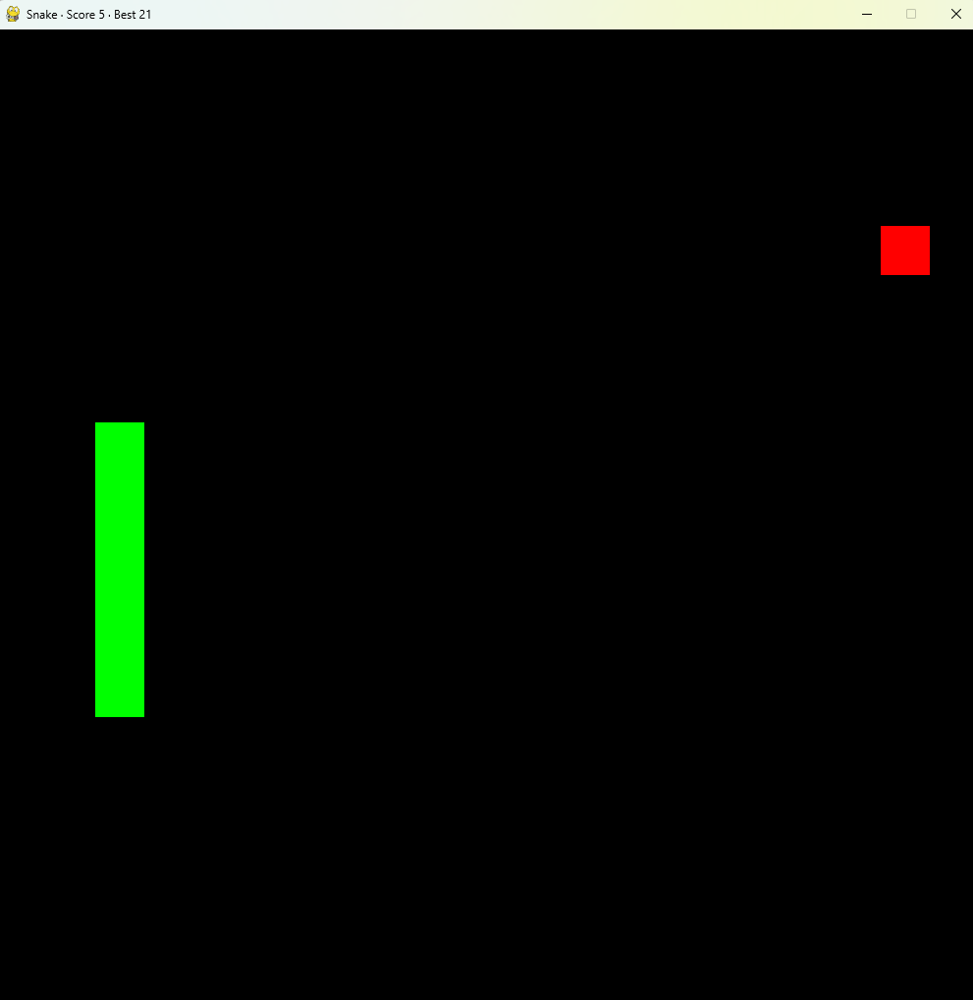

# Snake Game

Classic Snake in Python with [pygame-ce](https://github.com/pygame-community/pygame-ce). It's an intro project.



## How to play

- Steer the green snake to the red food. Each food makes the snake one tile longer and adds a point.
- The round ends when the snake hits a wall or its own body, and a new round starts right away.
- The title bar shows this round's score and the best score since you opened the window.

## Controls

- The arrow keys steer. The snake waits for your first key press.
- Close the window to quit.

## Setup

1. Install [uv](https://docs.astral.sh/uv/getting-started/installation/).
2. Clone the repo and start the game. The first run installs Python 3.14 and pygame-ce if you don't have them.

   ```bash
   git clone https://github.com/ralphsulioti/Snake_Game.git
   cd Snake_Game
   uv run snake_game.py
   ```

## Checks

```bash
uv run ruff check
uv run ruff format --check
uv run pytest
```
